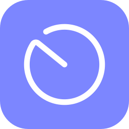

<div align="center">



# SolRadar

A Vencord plugin that watches Discord for Sol's RNG private server links and joins them for you.

[](version.json)
[](https://vencord.dev)
[](LICENSE)
[](https://github.com/masutty/solradar-helper)


</div>

## About

SolRadar runs inside Discord as a Vencord plugin. It reads the messages in the servers you choose, finds private server links for the biomes, weathers and merchants you care about, and opens them in Roblox.

It is an alternative to selfbot snipers. It needs no Discord token and sends nothing extra to Discord: it reacts to the messages your Discord client already receives.

> [!NOTE]
> SolRadar is not affiliated with Vencord or with Sol's RNG. Do not ask for help in Vencord's Discord server, they can't help with this plugin. Use the [SolRadar support server](https://discord.gg/EfWHGGz7MG) instead.

## Installing

### With SolRadar Helper (recommended)

Use [SolRadar Helper](https://github.com/masutty/solradar-helper) and follow the instructions on its page. It installs Git and Node.js if needed, builds Vencord with SolRadar and patches Discord. Run it again to update.

### Manual install (if you know what you're doing)

Custom plugins need Vencord built from source. Follow the [custom plugins guide](https://docs.vencord.dev/installing/custom-plugins/), then in `src/userplugins` run:

```sh
git clone https://github.com/masutty/solradar
```

Build and inject Vencord as the guide describes. To update later, run `git pull` in the plugin folder and build again.

> [!TIP]
> Installed SolRadar from GitLab before? Point your copy to GitHub once, in the plugin folder:
> ```sh
> git remote set-url origin https://github.com/masutty/solradar.git
> git pull
> ```
> SolRadar Helper does this for you on its next update.

## Features

- **Fully customizable triggers**: match any biome, weather, merchant or anything else by keywords, role pings, servers, channels, users, etc. Default triggers for biomes, weathers and merchants are included.
- **Instant auto-join** for the triggers you pick.
- **Fake biome detection**: checks the biome after you join and can close Roblox if it is bait.
- **Snipe History and Stats** to see what you joined and what was real.
- **Works with your macro\***: closes it when a snipe happens.

\* Needs a quick setup in Settings.

## Configuration

Everything is in the SolRadar menu: click the SolRadar button in the chat bar.

### Quick start

1. Open the **Triggers** tab.
2. Click **⋯** and choose **Import default triggers**, then **Add as new**.
3. The default triggers come turned off. Click the icon of each trigger you want to turn it on.
4. Turn on auto-join: right-click the SolRadar button in the chat bar. This turns auto-join and notifications on or off together.

That's it. SolRadar now joins the links for the triggers you turned on.

> [!NOTE]
> **A link is joined only if it passes every level, in this order:**
> 1. **Server, channel and user filters, etc.** in Settings. A message they block is ignored by every trigger.
> 2. **The trigger is on.** A trigger that is off never matches.
> 3. **The trigger's own filters**, if it has any (only some users or channels, never some servers or channels, etc.).
> 4. **Auto-join is on globally *and* on the trigger.** Both must be on. With either one off, the snipe is still saved to Snipe History, but you don't join.
>
> Notifications work the same way as step 4: on globally and on the trigger.

> [!TIP]
> Not sure if a message would be sniped? Hover it and click the SolRadar button in the message menu. Turn this button on first in Vencord's settings for SolRadar (Vencord → Plugins → SolRadar).

### Good to know

- **Link check is off by default.** It needs a `.ROBLOSECURITY` cookie. This is optional: snipes work without it, the check only makes them safer. Use an alt account for it.

## Privacy

- It never sends your Discord token anywhere.
- It has no telemetry.
- It only connects to the internet for:
  - GitHub, once a day, to check for a new version. You can turn this off in Settings, but then you won't know when a fix comes out.
  - Roblox, only for the link check and the biome check, when you turn them on.
  - The webhooks you set for forwarding.

## Credits

- [Vencord](https://github.com/Vendicated/Vencord): the client mod this plugin runs in.
- [maxstellar/maxstellar-Biome-Macro](https://github.com/maxstellar/maxstellar-Biome-Macro): biome icons.
- [vexthecoder/OysterDetector](https://github.com/vexthecoder/OysterDetector): merchant icons.
- [cresqnt-sys/MultiScope](https://github.com/cresqnt-sys/MultiScope/tree/94f1f06114a3e7cbff64e5fd0bf31ced99b0af79): biome detection logic (GPL-3.0, commit 94f1f06).
- Radar icon: "Radar" from the Solar Line Duotone Icons collection by [Solar Icons](https://www.svgrepo.com/collection/solar-line-duotone-icons/), via [SVG Repo](https://www.svgrepo.com), licensed under [CC BY 4.0](https://creativecommons.org/licenses/by/4.0/). Recolored and placed on a colored tile.

## License

[AGPL-3.0-or-later](LICENSE). Source files carry Vencord's required `GPL-3.0-or-later` header, but the plugin as a whole is AGPL-3.0-or-later because it adapts AGPL-licensed logic.

---

This project was largely created with the help of AI (Claude), and reviewed by me, with manual adjustments where needed. Made with ❤️ + 🤖 by masutty.
